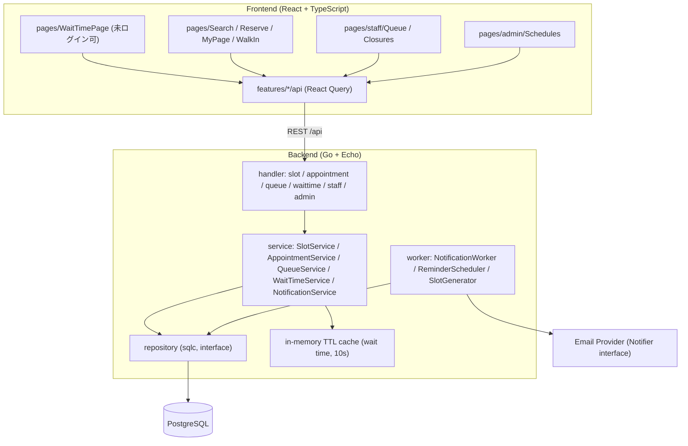
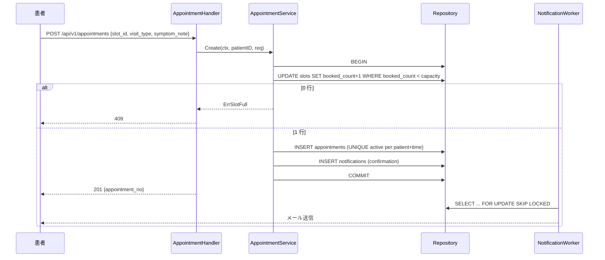
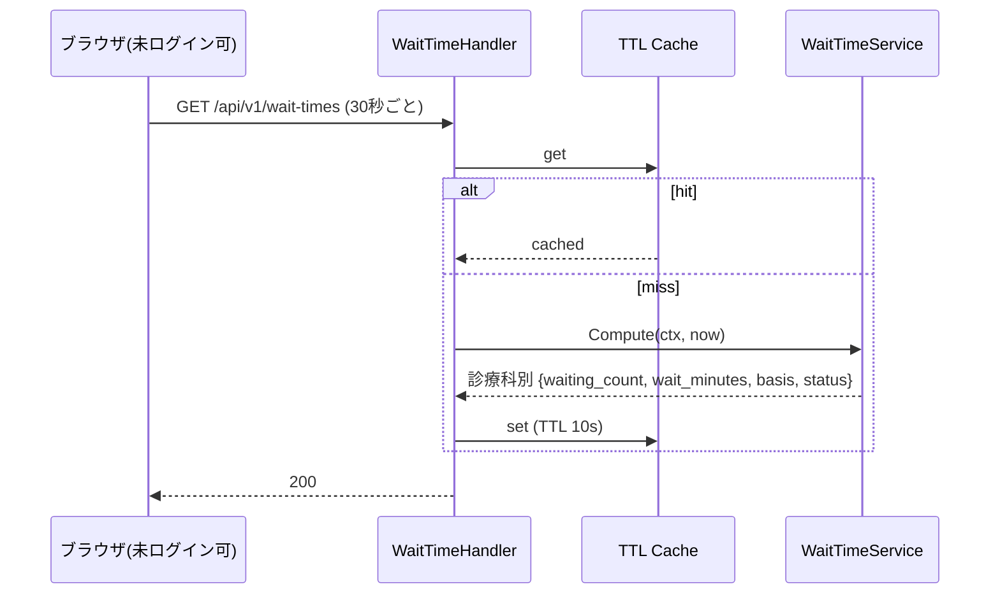
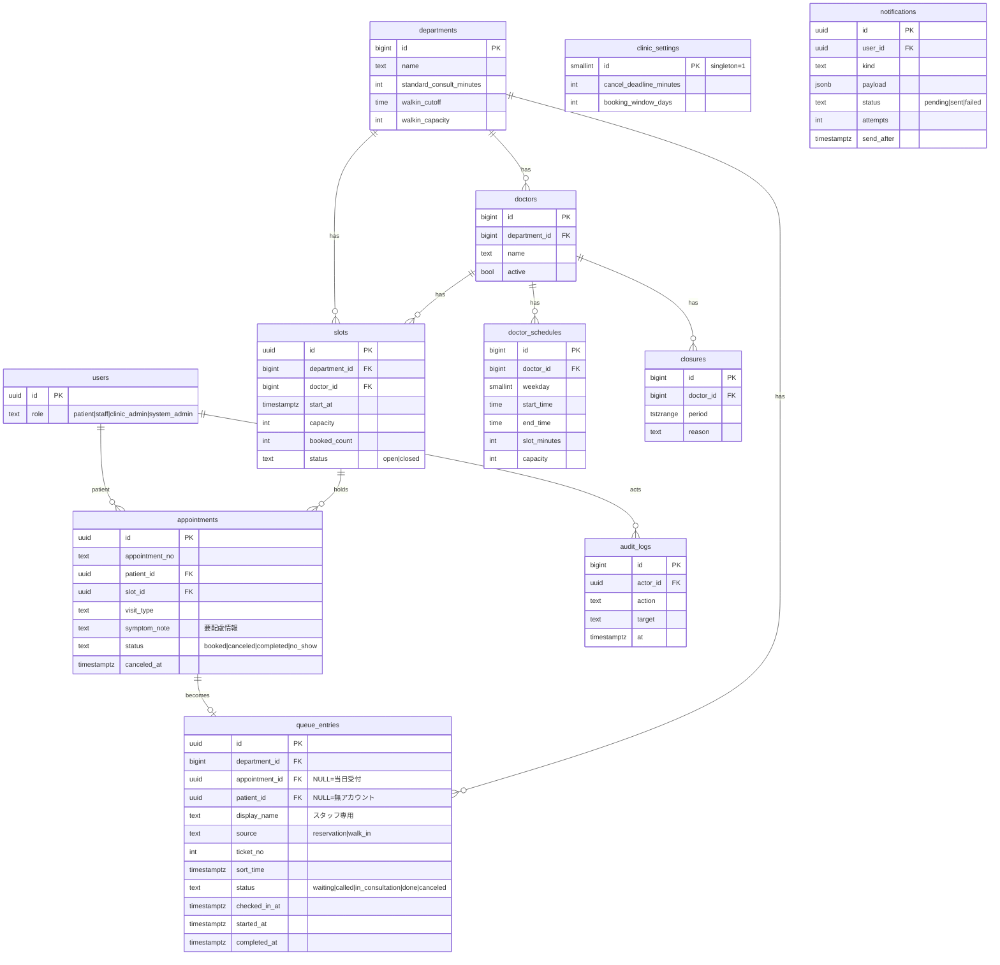

# Technical Design Document: clinic-reservation

**ステータス**: approved
**要件参照**: .kiro/specs/clinic-reservation/requirements.md
**作成日**: 2026-10-10

---

## Overview

**Purpose**: 病院・クリニックの診察予約（Web・当日受付）と、診療科ごとの現在の待ち時間表示を提供する。

**Users**: 患者 / 受付スタッフ / クリニック管理者

**Impact**: 新規フィーチャー。認証は `user-auth` に依存する。`users.role` の値（patient / staff / clinic_admin / system_admin）は user-auth 側のマイグレーション（000001）で定義し、本フィーチャーでは変更しない。外部システム（電子カルテ等）とは連携せず自システム内で完結する。

### Goals
- 予約枠の原子的な確保（ダブルブッキング 0 件）
- 予約患者と当日受付患者を単一の待機列で管理し、待ち時間を実績ベースで算出
- 待ち時間の公開表示（未ログイン可・個人情報なし・30 秒以内更新）
- 通知はアウトボックス方式で、予約処理と疎結合に送信

### Non-Goals
- 電子カルテ・レセプト・既存受付システム連携
- 複数医療機関（マルチテナント）。初期は 1 デプロイ = 1 医療機関
- オンライン診療、決済、SMS/LINE 通知（`Notifier` interface で将来差し替え可能にする）
- WebSocket/SSE によるプッシュ更新（初期はポーリング。後述）

---

## Architecture

### High-Level Architecture



**Architecture Integration**: Steering structure.md の SPA + REST、handler→service→repository の層分離に従う。サービスは repository interface のみに依存し、mockery でモック化する。

**Technology Stack**: Steering tech.md のとおり（Go 1.23 / Echo v4 / sqlc + pgx / golang-migrate / React 18 + TanStack Query / Tailwind）。新規ライブラリは追加しない。メール送信は標準の SMTP（`net/smtp`）を `Notifier` interface の実装として用意する。

### 主要設計判断

| 判断 | 採用 | 理由 |
|------|------|------|
| 枠の排他制御 | `UPDATE slots SET booked_count = booked_count + 1 WHERE id=$1 AND booked_count < capacity` の単一文 + 同一トランザクションで予約挿入 | 行ロック待ちのみで済み、デッドロックを避けられる。0 行更新 → 409 |
| 待機列の統一 | 予約・当日受付とも `queue_entries` に入れる | 待ち時間算出を 1 つの列に対して行える（REQ-008-AC-2） |
| 待機順序 | 予約: `GREATEST(予約時刻, 来院受付時刻)` / 当日: 受付時刻 | 遅刻した予約患者が先着の当日患者を追い越さない |
| 待ち時間更新 | 30 秒間隔ポーリング + サーバ 10 秒 TTL キャッシュ | 公開エンドポイントの DB 負荷を一定に抑える。SSE は将来拡張 |
| 通知 | `notifications` アウトボックス + ワーカー（SKIP LOCKED で取得、リトライ） | 予約確定を外部 SMTP の失敗から切り離す |
| 患者の無アカウント受付 | スタッフ登録の当日受付は `patient_id` NULL・`display_name` のみ許可 | 電話・窓口来院でも待機列に載せる |

### 待ち時間の算出

```
ahead   = 自分より前の status IN (waiting, called, in_consultation) の件数（同一診療科）
avg     = 当日の完了済み診察の直近 20 件の平均所要分（診察開始→完了）
basis   = avg  (実績 ≥ 3 件)
        | departments.standard_consult_minutes (実績 < 3 件、設定あり) → basis="standard"
        | 算出不可 (どちらも無し)
lanes   = 当該診療科で現在診察中/出勤中の医師数 (≥1)
wait    = ceil(ahead * avg / lanes)
```

- 診療時間外・休診・全医師不在の場合は `status: "unavailable"` と `reason`（`before_hours` / `closed` / `no_data`）を返し、数値は返さない（REQ-004-AC-5）。
- 応答に `basis`（`actual` / `standard`）、`updated_at`、注記文言を含める（REQ-004-AC-6）。
- 医師指名の予約は医師別の列で算出する拡張余地を残すが、初期は診療科単位で公開する。

### Sequence Diagram（予約確定）



### Sequence Diagram（待ち時間表示）



---

## API Design

| Method | Path | 説明 | Auth | REQ-ID |
|--------|------|------|------|--------|
| GET | /api/v1/departments | 診療科一覧 | none | REQ-001 |
| GET | /api/v1/doctors?department_id= | 医師一覧 | none | REQ-001 |
| GET | /api/v1/slots?department_id=&doctor_id=&date= | 空き枠検索 | none | REQ-001 |
| POST | /api/v1/appointments | 予約確定 | patient | REQ-002 |
| GET | /api/v1/appointments/me | 自分の予約一覧 | patient | REQ-003 |
| PATCH | /api/v1/appointments/{id} | 日時変更（枠の原子的付替え） | patient | REQ-003 |
| DELETE | /api/v1/appointments/{id} | キャンセル | patient | REQ-003 |
| GET | /api/v1/wait-times | 診療科別の待ち人数・待ち時間 | none | REQ-004, 007 |
| GET | /api/v1/appointments/{id}/position | 自分の順番・呼出見込み | patient(本人) | REQ-004 |
| POST | /api/v1/walk-ins | 当日受付（患者本人） | patient | REQ-008 |
| POST | /api/v1/staff/walk-ins | 当日受付（スタッフ代行・無アカウント可） | staff | REQ-008 |
| POST | /api/v1/staff/queue/{id}/check-in | 予約患者の来院受付 | staff | REQ-005 |
| POST | /api/v1/staff/queue/{id}/call | 呼出 | staff | REQ-005 |
| POST | /api/v1/staff/queue/{id}/start | 診察開始 | staff | REQ-005 |
| POST | /api/v1/staff/queue/{id}/complete | 診察完了 | staff | REQ-005 |
| GET | /api/v1/staff/queue?department_id= | 待機列（氏名・症状メモを含む） | staff | REQ-005, 007 |
| POST | /api/v1/staff/closures | 休診・医師不在設定（既存予約者へ通知） | staff | REQ-005 |
| PUT | /api/v1/admin/schedules | 診療時間・枠長・定員の設定と枠生成 | clinic_admin | REQ-006 |
| PUT | /api/v1/admin/settings | 受付期間・キャンセル期限・標準診察時間 | clinic_admin | REQ-006, 004 |

パスは Steering の kebab-case 規約に従う。OpenAPI 定義を正とし、フロント型は `openapi-typescript` で生成する。

### リクエスト / レスポンス例

```json
// POST /api/v1/appointments
{ "slot_id": "7b1c…", "visit_type": "revisit", "symptom_note": "3日前から咳" }

// 201
{ "id": "a91f…", "appointment_no": "A-20261012-0042", "slot_start": "2026-10-12T09:30:00+09:00",
  "department": "内科", "doctor": "山田 太郎" }

// 409（満席）
{ "error": "slot_full", "message": "この枠は満席になりました。別の枠をお選びください" }
```

```json
// GET /api/v1/wait-times  ← 個人情報を含まない
{
  "updated_at": "2026-10-12T09:41:10+09:00",
  "note": "待ち時間は目安です。混雑状況により変動します",
  "departments": [
    { "department_id": 1, "name": "内科", "status": "available",
      "waiting_count": 6, "wait_minutes": 35, "basis": "actual" },
    { "department_id": 2, "name": "小児科", "status": "unavailable", "reason": "before_hours" }
  ]
}
```

---

## Database Design



| テーブル | 主な制約・インデックス | 説明 |
|---------|----------------------|------|
| slots | `CHECK (booked_count <= capacity)`、`UNIQUE (doctor_id, start_at)`、`INDEX (department_id, start_at)` | 予約枠。二重確保の最終防壁 |
| appointments | 部分ユニーク `UNIQUE (patient_id, slot_id) WHERE status='booked'`、重複時間帯は service 層で検証 | 予約 |
| queue_entries | `INDEX (department_id, status, sort_time)`、`UNIQUE (department_id, ticket_no, date)` | 待機列。算出クエリの主対象 |
| notifications | `INDEX (status, send_after)` | アウトボックス |
| users | 変更なし（`role` は user-auth 000001 で定義済み。値は patient / staff / clinic_admin / system_admin） | ロール認可 |

- マイグレーションは up/down ペアで作成する。
- 診察所要時間は `completed_at - started_at` から導出し、別テーブルは持たない。

---

## Component Design

| モジュール | 責任 |
|-----------|------|
| `handler/slot`, `handler/appointment` | 検索・予約・変更・キャンセルの HTTP 入出力のみ |
| `handler/waittime` | 公開 API。認証不要、レートリミット適用 |
| `handler/staff`, `handler/admin` | ロールミドルウェアで保護 |
| `service/SlotService` | 枠検索、スケジュールからの枠生成（日次ジョブ + 管理者操作時） |
| `service/AppointmentService` | 排他確保、重複検証、キャンセル期限、変更の原子処理 |
| `service/QueueService` | 受付・当日受付・状態遷移（waiting→called→in_consultation→done）の検証 |
| `service/WaitTimeService` | 上記算出式。キャッシュ越しに利用 |
| `service/NotificationService` | アウトボックスへの登録 |
| `worker/*` | 通知送信、前日リマインド、「あと N 人」通知、日次枠生成 |
| `frontend features/waittime/api` | `useWaitTimes`（`refetchInterval: 30000`） |

状態遷移は `QueueService` に集約し、不正遷移（例: waiting から done）は 409 を返す。

---

## Security Considerations

| 脅威 | 対策 | REQ-ID |
|------|------|--------|
| 要配慮個人情報（症状メモ）の漏えい | 本人と staff 以上のみ参照。公開 API には一切含めない（DTO を分離） | REQ-007-AC-2 |
| 待ち時間からの個人推測 | 公開 API は件数・分のみ。少数時も氏名・受付番号は返さない | REQ-007-AC-1 |
| 他人の予約・順番参照（IDOR） | `patient_id = JWT subject` を WHERE 条件に含める | REQ-003, 004 |
| 権限昇格 | role をサーバ側で検証。`/api/v1/staff`・`/api/v1/admin` はミドルウェアで拒否 | REQ-005-AC-4 |
| 公開 API への過負荷 | 10 秒キャッシュ + `ulule/limiter` | REQ-004 |
| 予約の乱用（大量枠占有） | 同一患者の未来予約数の上限、重複時間帯拒否、当日受付はレートリミット | REQ-002-AC-5 |
| SQL インジェクション | sqlc のパラメータバインドのみ | — |
| 通信盗聴・監査 | TLS 必須、個人情報アクセスを `audit_logs` に記録 | REQ-007-AC-3 |
| 通知本文からの漏えい | メールに症状・診断を含めない（日時・診療科・予約番号のみ） | REQ-007 |

---

## Error Handling

| エラー種別 | HTTP / エラーコード | ログレベル | 対応策 |
|-----------|-------------------|----------|------|
| 枠が満席 | 409 `slot_full` | info | 別枠の選択を促す |
| 重複予約 | 409 `duplicate_appointment` | info | 既存予約を案内 |
| キャンセル期限超過 | 422 `cancel_deadline_passed` | info | 医療機関への連絡方法を表示 |
| 当日受付の締切・定員 | 422 `walkin_closed` | info | 理由を表示 |
| 不正な状態遷移 | 409 `invalid_transition` | warn | 最新状態を再取得 |
| 権限不足 | 403 | warn | 監査ログ |
| 入力不正 | 422 + フィールド別エラー | info | — |
| 待ち時間算出不可 | 200 + `status: unavailable` | info | 理由を表示（エラーにしない） |
| 通知送信失敗 | — | error | 指数バックオフで最大 5 回再試行、以後 `failed` |

ログは zerolog で `X-Request-ID` を必ず含める。

---

## Non-Functional Requirements 対応

| NFR | 設計上の対応 |
|-----|------------|
| パフォーマンス | 予約確定は単一トランザクション・単一 UPDATE で 3 秒以内（REQ-002-AC-4）。待ち時間は 10 秒キャッシュ + 該当インデックスで定数時間に近い |
| セキュリティ | 上記表。ロール認可、IDOR 対策、監査ログ、TLS |
| 可用性 | 通知障害は予約処理に影響しない。待ち時間 API 障害時もフロントは前回値と「更新できません」を表示 |
| 正確性 | 待ち時間は受付スタッフの操作記録に依存。スタッフ画面は「呼出・開始・完了」を 1 タップで記録できる UI にする |

---

## Design System

参照: [design-system/MASTER.md](../../design-system/MASTER.md)

| 項目 | 内容 |
|------|------|
| **Primary Color** | `#0D9488`（primary-500） |
| **Secondary Color** | 既存 MASTER.md の accent-500（CTA: 予約確定） |
| **フォントペア** | Inter / Noto Sans JP |
| **スタック** | React 18 + TypeScript + TailwindCSS |

> MASTER.md は施設予約向けに生成済み。医療向けでも色・タイポグラフィは流用可能（AA 適合済み）。待ち時間カードなど固有画面は `design-system/pages/wait-time.md` でオーバーライドする想定。
