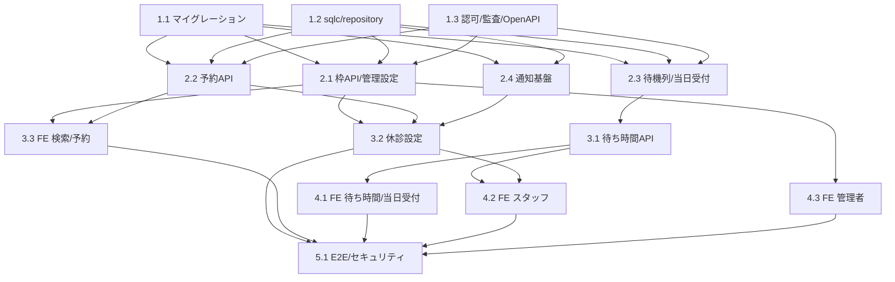

# Implementation Plan: clinic-reservation

**フィーチャー**: 病院・クリニック向け Web 予約と現在の待ち時間表示
**要件参照**: .kiro/specs/clinic-reservation/requirements.md
**設計参照**: .kiro/specs/clinic-reservation/design.md
**作成日**: 2026-10-10
**ステータス**: approved

> 前提: `user-auth`（users テーブル・JWT・Go 基盤）が先行して実装されること。

---

## Task List

- [x] 1. 基盤                                                    [P0]
- [x] 1.1 DB マイグレーション作成                                  [P0]
  - users.role は user-auth 000001 で定義済みのため変更しない（番号は 000004 以降から開始）
  - departments, doctors, doctor_schedules, slots を作成（CHECK booked_count <= capacity、UNIQUE doctor_id+start_at）
  - appointments（部分ユニーク patient_id+slot_id WHERE status='booked'）、queue_entries、closures、notifications、audit_logs を作成
  - 設計書記載のインデックスを付与
  - 全マイグレーションを up/down ペアで作成し、チェックサム検証を CI に含める
  - _Requirements: REQ-002-AC-2, REQ-005-AC-4, REQ-007-AC-3, REQ-009-AC-1_
  - _Parallel: P0（依存なし）_

- [x] 1.2 sqlc クエリと repository interface                       [P0]
  - 読み取り用・書き込み用 SQL を分けて作成（slots 条件付き UPDATE、queue 集計、通知の SKIP LOCKED 取得を含む）
  - Queries を包む repository interface を定義し mockery でモック生成
  - _Requirements: REQ-002-AC-2, REQ-004-AC-2_
  - _Parallel: P0（依存なし。スキーマ確定は 1.1 と並行して合意）_

- [x] 1.3 ロール認可・監査ログ・OpenAPI 定義                         [P0]
  - JWT クレームの role を検証する Echo ミドルウェア（staff / clinic_admin）
  - 個人情報アクセスの監査ログ記録ミドルウェア
  - 全 API の OpenAPI 定義を作成し openapi-typescript で型生成を設定
  - 公開 API 用レートリミットを設定（ulule/limiter）
  - _Requirements: REQ-005-AC-4, REQ-007-AC-2, REQ-007-AC-3_
  - _Parallel: P0（依存なし）_

- [x] 2. コアバックエンド                                          [P1]
- [x] 2.1 診療科・医師・枠 API と管理者設定                          [P1]
  - GET /api/v1/departments, /api/v1/doctors, /api/v1/slots（満席・休診・締切を選択不可として返す）
  - SlotService: doctor_schedules からの枠生成と日次ジョブ
  - PUT /api/v1/admin/schedules, /api/v1/admin/settings（診療時間・枠長・定員・受付期間・キャンセル期限・標準診察時間）
  - _Requirements: REQ-001-AC-1, REQ-001-AC-2, REQ-001-AC-3, REQ-006-AC-1, REQ-006-AC-2_
  - _Parallel: P1（依存: 1.1, 1.2, 1.3）_

- [x] 2.2 予約 API（確定・一覧・変更・キャンセル）                    [P1]
  - AppointmentService: 単一 UPDATE による枠確保と予約挿入を同一トランザクションで実施、0 行なら 409
  - 同一時間帯の重複予約拒否、確定応答 3 秒以内
  - キャンセル期限の判定、枠の解放、変更時の新枠確保と旧枠解放の原子処理
  - 自分の予約一覧（patient_id = JWT subject で絞込）
  - 症状メモを本人・スタッフ以外に返さない DTO 分離
  - 同時リクエストによる定員超過が起きない並行テスト
  - _Requirements: REQ-002-AC-1, REQ-002-AC-2, REQ-002-AC-4, REQ-002-AC-5, REQ-003-AC-1, REQ-003-AC-2, REQ-003-AC-3, REQ-003-AC-4, REQ-007-AC-2_
  - _Parallel: P1（依存: 1.1, 1.2, 1.3）_

- [x] 2.3 待機列とスタッフ操作・当日受付                              [P1]
  - QueueService: 状態遷移（waiting→called→in_consultation→done）と不正遷移の 409
  - 予約患者の来院受付（sort_time = GREATEST(予約時刻, 受付時刻)）
  - 当日受付（患者本人 / スタッフ代行・無アカウント可）、受付番号発行、締切・定員の判定
  - GET /api/v1/staff/queue（氏名・症状メモを含む）、call / start / complete の各 API
  - _Requirements: REQ-005-AC-1, REQ-005-AC-2, REQ-005-AC-4, REQ-008-AC-1, REQ-008-AC-2, REQ-008-AC-3, REQ-007-AC-2_
  - _Parallel: P1（依存: 1.1, 1.2, 1.3）_

- [x] 2.4 通知基盤（アウトボックス・メール・リマインド）               [P1]
  - Notifier interface と SMTP 実装、NotificationService（notifications へ登録）
  - ワーカー: SKIP LOCKED で取得、指数バックオフで最大 5 回再試行
  - 予約確認・キャンセル・前日リマインド・「あと N 人」通知の本文テンプレート（症状・診断は含めない）
  - ReminderScheduler
  - _Requirements: REQ-002-AC-3, REQ-002-AC-6, REQ-003-AC-2, REQ-007-AC-4_
  - _Parallel: P1（依存: 1.1, 1.2）_

- [x] 3. 待ち時間・休診・患者向け UI                                [P2]
- [x] 3.1 待ち時間算出と公開 API                                    [P2]
  - WaitTimeService: 待ち人数 × 直近 20 件の平均所要時間 ÷ 診察中医師数（切り上げ）
  - 実績 3 件未満は標準診察時間（basis=standard）、無ければ unavailable（reason 付き）
  - GET /api/v1/wait-times（未ログイン可・10 秒 TTL キャッシュ・個人情報なし・注記付き）
  - GET /api/v1/appointments/{id}/position（本人のみ。あと N 人と呼出見込み）
  - _Requirements: REQ-004-AC-1, REQ-004-AC-2, REQ-004-AC-4, REQ-004-AC-5, REQ-004-AC-6, REQ-007-AC-1_
  - _Parallel: P2（依存: 2.3）_

- [x] 3.2 休診・医師不在の設定                                      [P2]
  - POST /api/v1/staff/closures: 該当枠を closed にし、既存予約者へ通知を登録
  - 休診中は待ち時間を unavailable(closed) にする
  - _Requirements: REQ-005-AC-3_
  - _Parallel: P2（依存: 2.1, 2.2, 2.4）_

- [x] 3.3 フロント: 検索・予約・マイページ                          [P2]
  - features/slot, features/appointment の React Query フック（api/ に集約）
  - 診療科・医師・日付の検索、予約フォーム（react-hook-form + zod）、満席時の再選択導線
  - マイページ（予約一覧・変更・キャンセル、期限超過時の案内）
  - _Requirements: REQ-001-AC-1, REQ-001-AC-2, REQ-001-AC-3, REQ-002-AC-1, REQ-003-AC-1, REQ-003-AC-2, REQ-003-AC-3, REQ-003-AC-4_
  - _Parallel: P2（依存: 2.1, 2.2）_

- [x] 4. 待ち時間・スタッフ・管理者 UI                              [P3]
- [x] 4.1 フロント: 待ち時間ページ・当日受付・順番表示               [P3]
  - useWaitTimes（refetchInterval 30 秒、取得失敗時は前回値と更新不可を表示）
  - 診療科別カード（待ち人数・分・basis・算出不可の理由・目安の注記）
  - 当日受付フォーム、予約詳細の順番表示
  - _Requirements: REQ-004-AC-1, REQ-004-AC-3, REQ-004-AC-4, REQ-004-AC-5, REQ-004-AC-6, REQ-008-AC-1, REQ-008-AC-3_
  - _Parallel: P3（依存: 3.1）_

- [x] 4.2 フロント: スタッフ画面                                    [P3]
  - 待機列一覧、来院受付・呼出・開始・完了を 1 タップで記録、当日受付の代行登録
  - 休診・医師不在の設定画面
  - _Requirements: REQ-005-AC-1, REQ-005-AC-2, REQ-005-AC-3, REQ-005-AC-4, REQ-008-AC-1_
  - _Parallel: P3（依存: 3.1, 3.2）_

- [x] 4.3 フロント: 管理者画面                                      [P3]
  - 診療時間・枠長・定員・受付期間・キャンセル期限・標準診察時間の設定
  - _Requirements: REQ-006-AC-1, REQ-006-AC-2_
  - _Parallel: P3（依存: 2.1）_

- [ ] 5. 検証                                                      [P4]
- [ ] 5.1 E2E・セキュリティ・統合テスト                             [P4]
  - Playwright: 検索→予約→キャンセル、当日受付→呼出→完了→待ち時間反映
  - 権限テスト（患者が staff/admin API を呼べない、他人の予約・順番を参照できない）
  - 公開 API に氏名・症状メモが含まれないことの確認、通知本文の確認
  - 外部システム接続が無いことの確認、個人情報保護法・安全管理ガイドラインのチェックリスト照合
  - _Requirements: REQ-002-AC-4, REQ-004-AC-3, REQ-005-AC-4, REQ-007-AC-1, REQ-007-AC-2, REQ-007-AC-3, REQ-007-AC-4, REQ-009-AC-1_
  - _Parallel: P4（依存: 3.2, 3.3, 4.1, 4.2, 4.3）_

---

## Dependency Graph

---

## Parallel Execution Waves

| Wave | Tasks | 前提条件 | 推定工数 |
|------|-------|---------|---------|
| P0 | 1.1, 1.2, 1.3 | user-auth 完了 | 各 0.5〜1 日 |
| P1 | 2.1, 2.2, 2.3, 2.4 | P0 完了 | 各 1.5〜3 日 |
| P2 | 3.1, 3.2, 3.3 | 各タスクの依存（上記グラフ） | 各 1.5〜2 日 |
| P3 | 4.1, 4.2, 4.3 | 各タスクの依存 | 各 1.5〜2 日 |
| P4 | 5.1 | P2・P3 完了 | 2〜3 日 |

> 3.3 と 4.3 は依存が P1 のみのため、P1 完了後に前倒し着手できる。

---

## Requirements Traceability

全 AC（REQ-001〜009）がいずれかのタスクに紐付いていることを確認済み。
