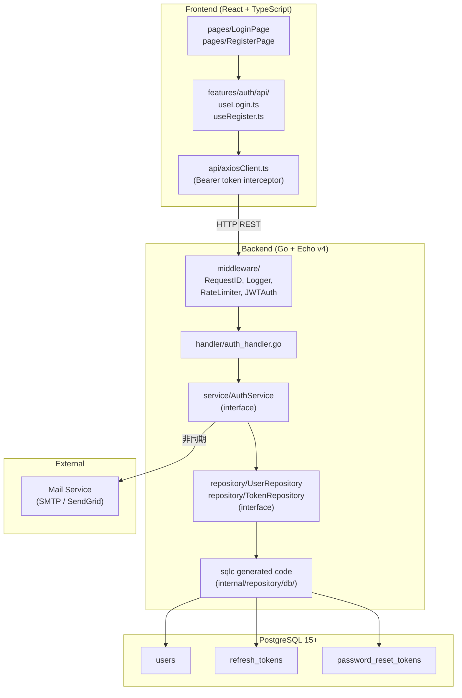
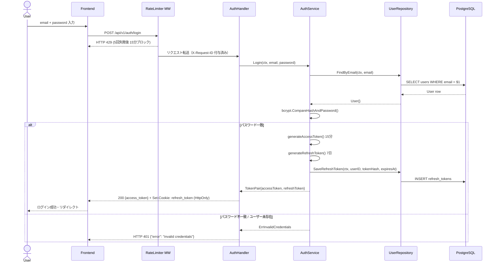
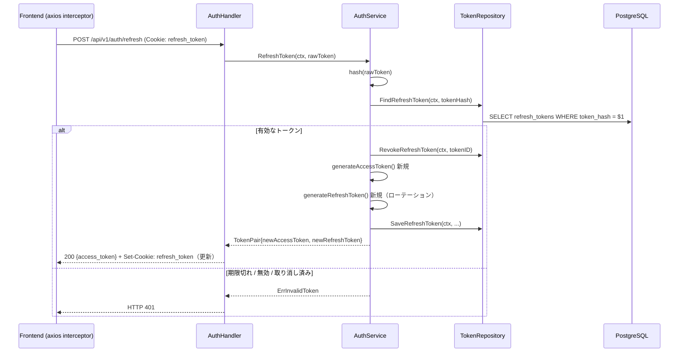
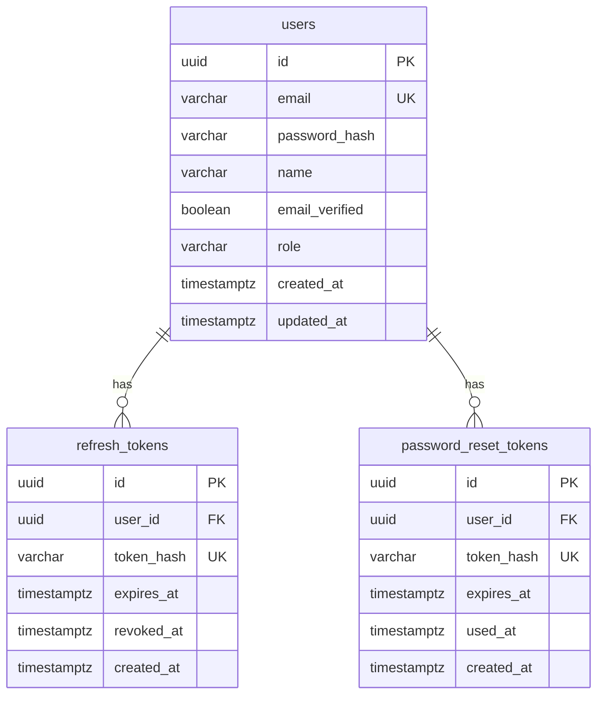

# Technical Design Document: user-auth

**ステータス**: approved
**要件参照**: .kiro/specs/user-auth/requirements.md
**作成日**: 2026-04-11

---

## Overview

**Purpose**: 施設予約管理システムの認証基盤を提供する。JWT（アクセストークン + リフレッシュトークン）方式で安全なセッション管理を実現する。

**Users**: 一般消費者（エンドユーザー）、将来的には施設管理者・システム管理者にも適用

**Impact**: 全ての認証要求機能（施設検索・予約・マイページ）の前提となる横断的関心事

### Goals
- JWT ベースのステートレス認証（アクセストークン 15 分 / リフレッシュトークン 7 日）
- bcrypt（cost ≥ 12）によるパスワード保護
- HttpOnly Cookie によるリフレッシュトークン管理（XSS 対策）
- interface ベースの DI 設計でテスタビリティを確保
- レートリミット・ユーザー存在推測防止による OWASP Top10 対応

### Non-Goals
- OAuth 2.0 / ソーシャルログイン（将来フェーズ）
- MFA / 多要素認証（将来フェーズ）
- セッション管理（Redis 等のサーバーサイドセッション）
- 決済・施設管理機能そのもの

---

## Architecture

### High-Level Architecture



**Architecture Integration**: Steering structure.md の `handler → service → repository` レイヤー構成に完全準拠。sqlc の `Queries` 構造体は `UserRepository` / `TokenRepository` interface 経由で DI する。

**Technology Stack**: Go 1.23+ / Echo v4 / sqlc + pgx/v5 / golang-jwt / bcrypt / zerolog / ulule/limiter（Steering tech.md 準拠）

---

### Sequence Diagram — ログインフロー



### Sequence Diagram — トークンリフレッシュフロー



---

## API Design

| Method | Path | 説明 | Auth | REQ-ID |
|--------|------|------|------|--------|
| POST | /api/v1/auth/register | ユーザー新規登録 | 不要 | REQ-001 |
| POST | /api/v1/auth/login | ログイン・トークン発行 | 不要 | REQ-002 |
| POST | /api/v1/auth/refresh | アクセストークン更新 | Cookie必須 | REQ-003 |
| POST | /api/v1/auth/logout | ログアウト | Bearer必須 | REQ-005 |
| POST | /api/v1/auth/password-reset/request | パスワードリセット申請 | 不要 | REQ-004 |
| POST | /api/v1/auth/password-reset/confirm | パスワードリセット確定 | 不要 | REQ-004 |

### POST /api/v1/auth/register

```json
// リクエスト
{
  "email": "user@example.com",
  "password": "SecurePass123!",
  "name": "山田 太郎"
}

// レスポンス 201
{
  "user_id": "01HXXX...",
  "email": "user@example.com",
  "name": "山田 太郎",
  "created_at": "2026-04-11T00:00:00+09:00"
}

// エラー 409
{ "error": "email already registered" }

// エラー 422
{
  "error": "validation failed",
  "details": [
    { "field": "password", "message": "must be at least 12 characters" }
  ]
}
```

### POST /api/v1/auth/login

```json
// リクエスト
{
  "email": "user@example.com",
  "password": "SecurePass123!"
}

// レスポンス 200
// Header: Set-Cookie: refresh_token=<token>; HttpOnly; Secure; SameSite=Strict; Path=/api/v1/auth/refresh
{
  "access_token": "eyJ...",
  "token_type": "Bearer",
  "expires_in": 900
}

// エラー 401
{ "error": "invalid credentials" }

// エラー 429
{ "error": "too many requests", "retry_after": 900 }
```

### POST /api/v1/auth/refresh

```json
// リクエスト: Cookie に refresh_token を含めて送信（ボディなし）

// レスポンス 200
// Header: Set-Cookie: refresh_token=<new_token>; HttpOnly; Secure; SameSite=Strict
{
  "access_token": "eyJ...",
  "token_type": "Bearer",
  "expires_in": 900
}
```

### POST /api/v1/auth/password-reset/request

```json
// リクエスト
{ "email": "user@example.com" }

// レスポンス 200（登録済み・未登録問わず同一レスポンス）
{ "message": "If the email is registered, a reset link has been sent." }
```

### POST /api/v1/auth/password-reset/confirm

```json
// リクエスト
{
  "token": "xxxxxxxx-xxxx-xxxx-xxxx-xxxxxxxxxxxx",
  "new_password": "NewSecurePass456!"
}

// レスポンス 200
{ "message": "password has been reset successfully" }

// エラー 400
{ "error": "invalid or expired token" }
```

---

## Database Design



| テーブル | カラム | 型 | 説明 |
|---------|-------|-----|------|
| users | id | uuid (PK) | ULID または uuid_generate_v4() |
| users | email | varchar(255) UK | NOT NULL、小文字正規化 |
| users | password_hash | varchar(72) | bcrypt ハッシュ（最大 72 bytes） |
| users | name | varchar(100) | 氏名 |
| users | email_verified | boolean | メール確認済みフラグ（default false） |
| users | role | varchar(20) | 'patient' / 'staff' / 'clinic_admin' / 'system_admin'（DEFAULT 'patient'、CHECK 制約。clinic-reservation との統合により 2026-10-10 に変更） |
| users | created_at | timestamptz | NOT NULL DEFAULT now() |
| users | updated_at | timestamptz | NOT NULL DEFAULT now() |
| refresh_tokens | token_hash | varchar(64) UK | SHA-256 ハッシュ（生トークンは保存しない） |
| refresh_tokens | revoked_at | timestamptz | NULL = 有効、非NULL = 取り消し済み |
| password_reset_tokens | token_hash | varchar(64) UK | SHA-256 ハッシュ |
| password_reset_tokens | used_at | timestamptz | NULL = 未使用 |

**インデックス方針**:
- `users(email)` — UNIQUE INDEX（ログイン・重複チェック）
- `refresh_tokens(token_hash)` — UNIQUE INDEX（リフレッシュ時高速検索）
- `refresh_tokens(user_id, revoked_at)` — INDEX（ユーザーの有効トークン一覧）
- `password_reset_tokens(token_hash)` — UNIQUE INDEX

---

## Component Design

### バックエンド層構成

```
backend/internal/
├── handler/
│   └── auth_handler.go       # Echo ハンドラー（HTTP 入出力のみ）
├── service/
│   ├── auth_service.go        # AuthService interface + 実装
│   └── auth_service_test.go   # mockery 生成モックを使ったユニットテスト
├── repository/
│   ├── user_repository.go     # UserRepository interface
│   ├── token_repository.go    # TokenRepository interface
│   └── db/                   # sqlc 生成コード（直接使用禁止）
├── domain/
│   └── user.go               # User エンティティ・ロール定義
├── middleware/
│   ├── request_id.go         # X-Request-ID 付与
│   ├── logger.go             # zerolog リクエストログ
│   ├── rate_limiter.go       # ulule/limiter（認証エンドポイント用）
│   └── jwt_auth.go           # echo-jwt wrapper（保護ルート用）
└── config/
    └── config.go             # viper による設定読み込み

backend/db/
├── query/
│   ├── user.sql              # users テーブル操作 SQL
│   └── token.sql             # refresh_tokens / password_reset_tokens SQL
└── migrations/
    ├── 000001_create_users.up.sql
    ├── 000001_create_users.down.sql
    ├── 000002_create_refresh_tokens.up.sql
    ├── 000002_create_refresh_tokens.down.sql
    ├── 000003_create_password_reset_tokens.up.sql
    └── 000003_create_password_reset_tokens.down.sql
```

### インターフェース定義

```go
// service/auth_service.go
type AuthService interface {
    Register(ctx context.Context, req RegisterRequest) (*UserResponse, error)
    Login(ctx context.Context, req LoginRequest) (*TokenPair, error)
    RefreshToken(ctx context.Context, rawRefreshToken string) (*TokenPair, error)
    Logout(ctx context.Context, rawRefreshToken string) error
    RequestPasswordReset(ctx context.Context, email string) error
    ConfirmPasswordReset(ctx context.Context, req PasswordResetConfirmRequest) error
}

// repository/user_repository.go
type UserRepository interface {
    Create(ctx context.Context, params CreateUserParams) (*User, error)
    FindByEmail(ctx context.Context, email string) (*User, error)
    FindByID(ctx context.Context, id uuid.UUID) (*User, error)
    UpdatePassword(ctx context.Context, userID uuid.UUID, passwordHash string) error
}

// repository/token_repository.go
type TokenRepository interface {
    SaveRefreshToken(ctx context.Context, params SaveRefreshTokenParams) error
    FindRefreshToken(ctx context.Context, tokenHash string) (*RefreshToken, error)
    RevokeRefreshToken(ctx context.Context, id uuid.UUID) error
    SavePasswordResetToken(ctx context.Context, params SavePasswordResetTokenParams) error
    FindPasswordResetToken(ctx context.Context, tokenHash string) (*PasswordResetToken, error)
    MarkPasswordResetTokenUsed(ctx context.Context, id uuid.UUID) error
}
```

### フロントエンド層構成

```
frontend/src/features/auth/
├── api/
│   ├── useRegister.ts    # POST /auth/register
│   ├── useLogin.ts       # POST /auth/login
│   ├── useLogout.ts      # POST /auth/logout
│   └── usePasswordReset.ts
├── components/
│   ├── LoginForm.tsx
│   ├── RegisterForm.tsx
│   └── PasswordResetForm.tsx
└── types/
    └── index.ts          # openapi-typescript 生成型の re-export

frontend/src/api/
└── axiosClient.ts        # Bearer token interceptor + 401 時自動リフレッシュ
```

---

## Security Considerations

| 脅威 | 対策 | REQ-ID |
|------|------|--------|
| パスワード漏洩 | bcrypt（cost ≥ 12）でハッシュ化。生パスワードは保存・ログ出力しない | REQ-001-AC-1 |
| ブルートフォース攻撃 | IP ベースレートリミット：5回失敗で 15 分ブロック（ulule/limiter） | REQ-002-AC-3 |
| トークン窃取（XSS） | リフレッシュトークンは HttpOnly Cookie。アクセストークンはメモリ保持（localStorage 禁止） | REQ-002-AC-4 |
| トークン窃取（CSRF） | SameSite=Strict Cookie。リフレッシュエンドポイントを `/api/v1/auth/refresh` に限定 | REQ-002-AC-4 |
| リプレイ攻撃 | リフレッシュトークンは使用後即座にローテーション（旧トークン無効化） | REQ-003-AC-3 |
| メールアドレス列挙 | ログイン失敗・パスワードリセット申請で「存在しない」ことを明示しない | REQ-002-AC-2, REQ-004-AC-2 |
| JWT 秘密鍵漏洩 | JWT_SECRET は環境変数のみ（viper 経由）。ソースコード禁止 | NFR |
| SQL インジェクション | sqlc による型安全クエリのみ使用。文字列結合禁止 | NFR |
| 過剰情報漏洩 | スタックトレースをレスポンスに含めない。zerolog でサーバーサイドのみロギング | NFR |

---

## Error Handling

| エラー種別 | HTTP ステータス | エラーコード | ログレベル | 対応策 |
|-----------|--------------|------------|----------|------|
| バリデーション失敗 | 422 | `validation_failed` | Info | フィールド単位エラーを返す |
| 認証情報不正 | 401 | `invalid_credentials` | Warn | 詳細を返さない（列挙防止） |
| トークン期限切れ | 401 | `token_expired` | Info | 再ログインを促す |
| トークン無効 | 401 | `invalid_token` | Warn | 再ログインを促す |
| メール重複 | 409 | `email_already_registered` | Info | 再登録を案内 |
| レートリミット超過 | 429 | `too_many_requests` | Warn | `retry_after` 秒を返す |
| リセットトークン無効 | 400 | `invalid_or_expired_token` | Info | 再申請を案内 |
| サーバー内部エラー | 500 | `internal_server_error` | Error | X-Request-ID をログに記録 |

全エラーレスポンスフォーマット:
```json
{
  "error": "<error_code>",
  "message": "<human readable>",
  "request_id": "<X-Request-ID>"
}
```

---

## Non-Functional Requirements 対応

| NFR | 設計上の対応 |
|-----|------------|
| パフォーマンス（ログイン p99 500ms） | bcrypt cost=12 は約 250ms。pgxpool 接続プール使用。zerolog はゼロアロケーション設計で低オーバーヘッド |
| セキュリティ（bcrypt cost ≥ 12） | `golang.org/x/crypto/bcrypt.GenerateFromPassword(pwd, 12)` |
| セキュリティ（レートリミット） | `ulule/limiter` を Echo ミドルウェアとして `/api/v1/auth/*` に適用。IP ベース、インメモリストア（開発）/ Redis（本番） |
| セキュリティ（HttpOnly Cookie） | `echo.Context.SetCookie()` で `HttpOnly: true, Secure: true, SameSite: http.SameSiteStrictMode` |
| 可用性（外部依存最小化） | メール送信は goroutine で非同期処理。メール失敗でも登録・リセット申請自体は成功とする |
| 法的（個人情報保護） | email・name は暗号化 DB 接続（TLS）経由のみアクセス。ログには出力しない。削除 API は将来フェーズで対応 |
