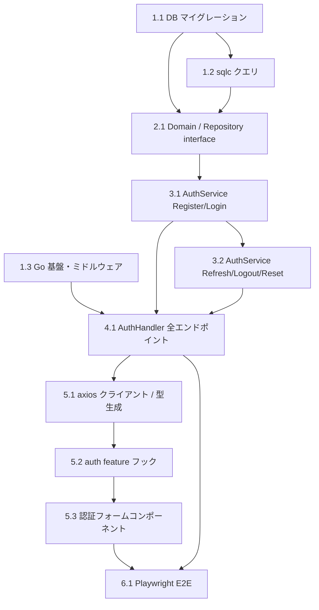

# Implementation Plan: user-auth

**フィーチャー**: ユーザー認証機能（登録・ログイン・JWT 発行・パスワードリセット）
**要件参照**: .kiro/specs/user-auth/requirements.md
**設計参照**: .kiro/specs/user-auth/design.md
**作成日**: 2026-04-11

---

## Task List

- [ ] 1. インフラストラクチャ基盤                                                  [P0]

- [ ] 1.1 DB マイグレーション作成（users / refresh_tokens / password_reset_tokens） [P0]
  - `backend/db/migrations/` に golang-migrate 形式で up/down ペアを作成する
  - `000001_create_users.up.sql`: users テーブル（id uuid PK, email UK, password_hash, name, email_verified, role varchar(20) NOT NULL DEFAULT 'patient' + CHECK (patient/staff/clinic_admin/system_admin), created_at, updated_at）
  - `000002_create_refresh_tokens.up.sql`: refresh_tokens テーブル（id, user_id FK, token_hash UK, expires_at, revoked_at, created_at）
  - `000003_create_password_reset_tokens.up.sql`: password_reset_tokens テーブル（id, user_id FK, token_hash UK, expires_at, used_at, created_at）
  - 各テーブルに必要なインデックスを定義する（users(email), refresh_tokens(token_hash, user_id+revoked_at), password_reset_tokens(token_hash)）
  - 全 down.sql でロールバック可能であることを確認する
  - _Requirements: REQ-001-AC-1, REQ-003-AC-3, REQ-004-AC-1_
  - _Parallel: P0（依存なし）_

- [ ] 1.2 sqlc 設定と SQL クエリファイルの作成                                      [P0]
  - `backend/sqlc.yaml` を作成する（pgx/v5 ドライバ、出力先 `internal/repository/db/`）
  - `backend/db/query/user.sql`: FindByEmail, FindByID, Create, UpdatePassword クエリを定義する
  - `backend/db/query/token.sql`: SaveRefreshToken, FindRefreshToken, RevokeRefreshToken, SavePasswordResetToken, FindPasswordResetToken, MarkPasswordResetTokenUsed クエリを定義する
  - `sqlc generate` で Go コードを生成し、コンパイルエラーがないことを確認する
  - _Requirements: REQ-001-AC-1, REQ-002-AC-1, REQ-003-AC-1, REQ-004-AC-1, REQ-005-AC-1_
  - _Parallel: P0（依存: 1.1）_

- [ ] 1.3 Go プロジェクト基盤 / 設定 / ミドルウェア                                 [P0]
  - `go.mod` を初期化し、echo/v4, pgx/v5, zerolog, viper, golang-jwt, bcrypt, go-playground/validator, ulule/limiter, mockery を追加する
  - `backend/internal/config/config.go`: viper で環境変数（DB_DSN, JWT_SECRET, JWT_REFRESH_SECRET, JWT_ACCESS_TTL, JWT_REFRESH_TTL, SMTP_*, RATE_LIMIT_*）を読み込む
  - `backend/internal/middleware/request_id.go`: X-Request-ID を生成・付与するミドルウェアを実装する
  - `backend/internal/middleware/logger.go`: zerolog による構造化ログミドルウェア（X-Request-ID を context 経由で引き回す）を実装する
  - `backend/internal/middleware/rate_limiter.go`: ulule/limiter を使い認証エンドポイント向け IP ベースレートリミットを実装する（IP 単位の汎用リミッター。ログインのアカウント単位ロックは AuthService の AttemptGuard で実装: 連続5回失敗→15分）
  - `backend/cmd/api/main.go`: Echo インスタンス・ルーティング・ミドルウェアチェインを組み立てる
  - _Requirements: REQ-002-AC-3_
  - _Parallel: P0（依存なし）_

- [ ] 2. ドメイン・Repository 層                                                    [P1]

- [ ] 2.1 ドメインモデルと Repository interface 定義                                [P1]
  - `backend/internal/domain/user.go`: User struct（ID, Email, PasswordHash, Name, EmailVerified, Role, CreatedAt, UpdatedAt）を定義する。Role 型と定数（RolePatient / RoleStaff / RoleClinicAdmin / RoleSystemAdmin）は clinic-reservation #6 で `backend/internal/domain/role.go` に定義済みのため再定義しない
  - `backend/internal/repository/user_repository.go`: UserRepository interface（Create, FindByEmail, FindByID, UpdatePassword）を定義する
  - `backend/internal/repository/token_repository.go`: TokenRepository interface（SaveRefreshToken, FindRefreshToken, RevokeRefreshToken, SavePasswordResetToken, FindPasswordResetToken, MarkPasswordResetTokenUsed）を定義する
  - sqlc 生成コードを使った各 interface の実装 struct を作成する
  - _Requirements: REQ-001-AC-1, REQ-002-AC-1, REQ-003-AC-1, REQ-004-AC-1, REQ-005-AC-1_
  - _Parallel: P1（依存: 1.1, 1.2）_

- [ ] 3. Service 層                                                                 [P1]

- [ ] 3.1 AuthService interface と Register / Login 実装                            [P1]
  - `backend/internal/service/auth_service.go`: AuthService interface を定義する（Register, Login, RefreshToken, Logout, RequestPasswordReset, ConfirmPasswordReset）
  - Register 実装: email 重複チェック → bcrypt ハッシュ化（cost=12）→ DB 保存 → 確認メールを goroutine で非同期送信
  - Login 実装: FindByEmail → bcrypt.CompareHashAndPassword → アクセストークン(15分) + リフレッシュトークン(7日)生成 → token_hash(SHA-256) を DB 保存
  - エラー型（ErrEmailAlreadyExists, ErrInvalidCredentials）を定義する
  - mockery で UserRepository / TokenRepository のモックを生成してユニットテストを作成する
  - _Requirements: REQ-001-AC-1, REQ-001-AC-2, REQ-001-AC-3, REQ-002-AC-1, REQ-002-AC-2, REQ-002-AC-4_
  - _Parallel: P1（依存: 2.1）_

- [ ] 3.2 AuthService — RefreshToken / Logout / PasswordReset 実装                  [P1]
  - RefreshToken 実装: rawToken を SHA-256 ハッシュ化 → FindRefreshToken → 期限・取り消しチェック → RevokeRefreshToken → 新規トークンペア生成・保存（ローテーション）
  - Logout 実装: Cookie からリフレッシュトークン取得 → RevokeRefreshToken → Cookie 削除
  - RequestPasswordReset 実装: FindByEmail（未存在でも同一レスポンス） → リセットトークン生成 → token_hash 保存 → goroutine でメール送信
  - ConfirmPasswordReset 実装: FindPasswordResetToken → 期限・使用済みチェック → UpdatePassword(bcrypt) → MarkPasswordResetTokenUsed
  - 各メソッドのユニットテストを作成する
  - _Requirements: REQ-003-AC-1, REQ-003-AC-2, REQ-003-AC-3, REQ-004-AC-1, REQ-004-AC-2, REQ-004-AC-3, REQ-004-AC-4, REQ-005-AC-1, REQ-005-AC-2_
  - _Parallel: P1（依存: 3.1）_

- [ ] 4. Handler 層                                                                 [P1]

- [ ] 4.1 AuthHandler — 全エンドポイント実装                                        [P1]
  - `backend/internal/handler/auth_handler.go` を実装する
  - POST /api/v1/auth/register: リクエストバリデーション（go-playground/validator）→ AuthService.Register → 201 レスポンス
  - POST /api/v1/auth/login: バリデーション → AuthService.Login → アクセストークンをレスポンスボディ、リフレッシュトークンを HttpOnly Cookie（SameSite=Strict, Secure, Path=/api/v1/auth/refresh）に設定
  - POST /api/v1/auth/refresh: Cookie からリフレッシュトークン取得 → AuthService.RefreshToken → トークンペア返却
  - POST /api/v1/auth/logout: AuthService.Logout → Cookie クリア → 200
  - POST /api/v1/auth/password-reset/request: AuthService.RequestPasswordReset → 200（常に同一レスポンス）
  - POST /api/v1/auth/password-reset/confirm: AuthService.ConfirmPasswordReset → 200
  - 統一エラーレスポンス形式（error, message, request_id）を実装する
  - httptest を使った統合テストを作成する（全エンドポイント）
  - _Requirements: REQ-001-AC-1, REQ-001-AC-2, REQ-001-AC-3, REQ-002-AC-1, REQ-002-AC-2, REQ-002-AC-4, REQ-003-AC-1, REQ-003-AC-2, REQ-004-AC-1, REQ-004-AC-4, REQ-005-AC-1_
  - _Parallel: P1（依存: 3.1, 3.2）_

- [ ] 5. フロントエンド実装                                                          [P2]

- [ ] 5.1 axios クライアントと openapi-typescript 型生成                             [P2]
  - バックエンドの OpenAPI 定義（`openapi.yaml`）を作成する（全 6 エンドポイント）
  - `openapi-typescript` で TypeScript 型を自動生成する（`frontend/src/api/types.ts`）
  - `frontend/src/api/axiosClient.ts` を実装する（Bearer トークン自動付与インターセプター + 401 時に /auth/refresh を呼び出して自動リトライ）
  - _Requirements: REQ-002-AC-1, REQ-003-AC-1_
  - _Parallel: P2（依存: 4.1）_

- [ ] 5.2 auth feature フック実装                                                   [P2]
  - `frontend/src/features/auth/api/useRegister.ts`: React Query の useMutation で POST /auth/register をラップ
  - `frontend/src/features/auth/api/useLogin.ts`: useMutation で POST /auth/login をラップ、成功時にアクセストークンをメモリ（Zustand/Context）に保存
  - `frontend/src/features/auth/api/useLogout.ts`: POST /auth/logout をラップ
  - `frontend/src/features/auth/api/usePasswordReset.ts`: request / confirm の 2 ステップをラップ
  - _Requirements: REQ-001-AC-1, REQ-002-AC-1, REQ-004-AC-1, REQ-005-AC-1_
  - _Parallel: P2（依存: 5.1）_

- [ ] 5.3 認証フォームコンポーネント実装                                             [P2]
  - `frontend/src/features/auth/components/LoginForm.tsx`: react-hook-form + zod でバリデーション付きログインフォームを実装する
  - `frontend/src/features/auth/components/RegisterForm.tsx`: 登録フォーム（email, password, name）を実装する
  - `frontend/src/features/auth/components/PasswordResetForm.tsx`: リセット申請・確定フォームを実装する
  - `frontend/src/pages/LoginPage.tsx`, `RegisterPage.tsx` を実装する（features を組み合わせる）
  - Vitest + Testing Library でコンポーネントユニットテストを作成する
  - _Requirements: REQ-001-AC-1, REQ-001-AC-3, REQ-002-AC-1, REQ-004-AC-1_
  - _Parallel: P2（依存: 5.2）_

- [ ] 6. E2E テスト                                                                  [P2]

- [ ] 6.1 Playwright による認証フロー E2E テスト                                     [P2]
  - 正常系: 登録 → ログイン → リフレッシュ → ログアウト の一連フローを Playwright でテストする
  - 異常系: 不正パスワードでのログイン失敗・レートリミット発火・パスワードリセットフローをテストする
  - _Requirements: REQ-001-AC-1, REQ-002-AC-1, REQ-002-AC-2, REQ-002-AC-3, REQ-004-AC-1, REQ-005-AC-1_
  - _Parallel: P2（依存: 5.3, 4.1）_

---

## Dependency Graph

---

## Parallel Execution Waves

| Wave | タスク | 前提条件 | 推定工数 |
|------|--------|---------|---------|
| P0 | 1.1, 1.3 | なし | 1.0 日 |
| P0 | 1.2 | 1.1 完了 | 0.5 日 |
| P1 | 2.1 | 1.1, 1.2 完了 | 0.5 日 |
| P1 | 3.1 | 2.1 完了 | 1.0 日 |
| P1 | 3.2 | 3.1 完了 | 1.0 日 |
| P1 | 4.1 | 3.1, 3.2, 1.3 完了 | 1.0 日 |
| P2 | 5.1 | 4.1 完了 | 0.5 日 |
| P2 | 5.2 | 5.1 完了 | 1.0 日 |
| P2 | 5.3 | 5.2 完了 | 1.0 日 |
| P2 | 6.1 | 5.3, 4.1 完了 | 0.5 日 |
